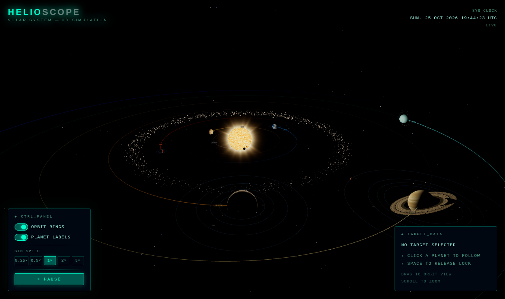
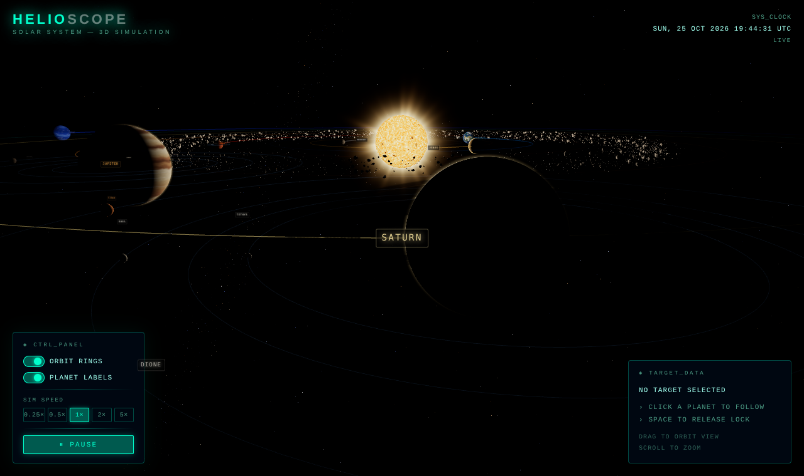

# Space Simulator

An interactive 3D solar system that runs in your browser. The Sun sits in the middle, the eight planets orbit it, a few moons tag along and there is an asteroid belt between Mars and Jupiter. Click a planet and the camera follows it around.

I made it to get comfortable with React Three Fiber, and I ended up caring a lot more about how it looks than I planned to.



## What you can do

- Drag to rotate, scroll to zoom. Zoom heads toward wherever your cursor is, which makes it easy to get close to a small planet.
- Click any planet to lock the camera onto it and read a quick summary. Press Space to let go.
- See how far the selected planet is from the Sun in AU.
- Pause time, or set the speed anywhere from 0.25x up to 5x.
- Turn orbit rings and planet labels on or off.
- Watch a live UTC clock tick away in the HUD, which is mostly there because it looks cool.

## A few things worth knowing

The sun is a custom shader, so the surface actually boils. There's granulation, the odd sunspot, a darker edge like the real thing, and a corona around it that only the bloom pass picks up.



Every planet texture is painted in code, no images downloaded at all. The noise is sampled on a sphere so there's no seam and no stretching at the poles. Earth gets continents, ice caps and its own cloud layer, Jupiter has swirling bands and the Great Red Spot, and Saturn's rings have the Cassini division in them. All of that gets painted in Web Workers while the loading screen runs, so the page never freezes.

Planets with air get a glowing atmosphere that only lights up on the side facing the sun.

The asteroid belt is about 1,400 actual lumpy rocks plus a few thousand bits of dust between Mars and Jupiter, and the whole belt drifts round with time.

Orbit lines fade out behind each planet like a little trail, and the background has twinkling stars in different colours plus a faint Milky Way band.

Distances and sizes are scaled so everything is visible on one screen. Planets are bigger and closer together than they are in real life, and the numbers shown for AU are worked out from the scaled orbits where Earth sits at 1.0.

## Stack

- React 19
- Three.js with React Three Fiber and Drei
- Custom GLSL shaders for the sun, corona, atmospheres and stars
- React Postprocessing for bloom and tone mapping
- GSAP for the camera moves
- Tailwind CSS 4
- Vite

## Running it

```bash
git clone https://github.com/mominmansoor/Space-Simulator
cd Space-Simulator
npm install
npm run dev
```

Then open the address Vite prints, usually http://localhost:5173.

To make a production build, run `npm run build`, and use `npm run preview` to look at the result.

## Project layout

```
src/
  components/   Scene, Planet, Moon, Sun, AsteroidBelt, Starfield, HUD and friends
  data/         planet and moon definitions
  hooks/        selection, pause and speed state
  shaders/      shared GLSL noise
  utils/        procedural texture painting (runs in Web Workers)
```
